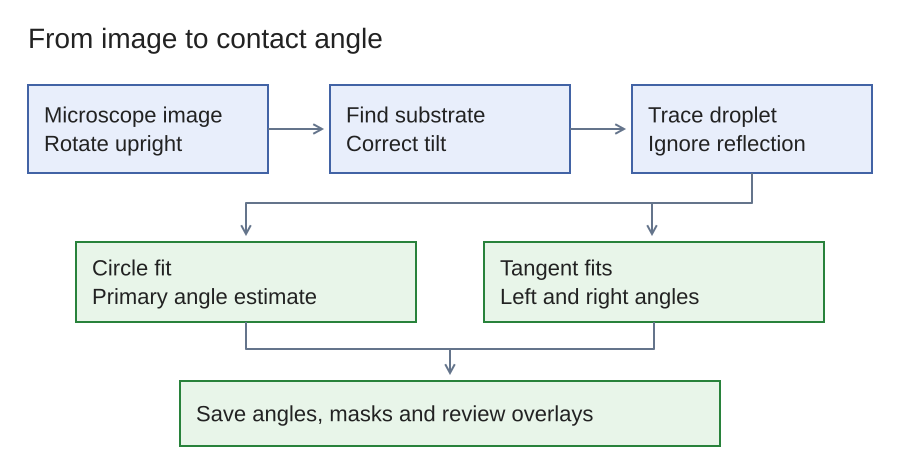
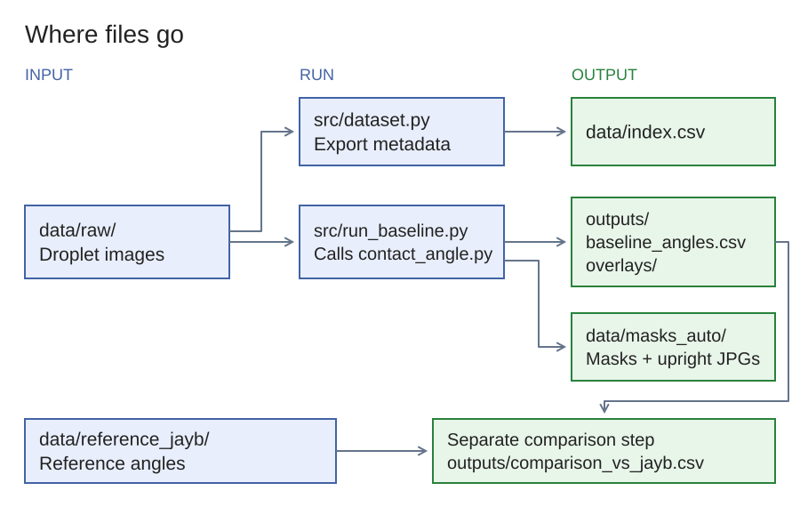
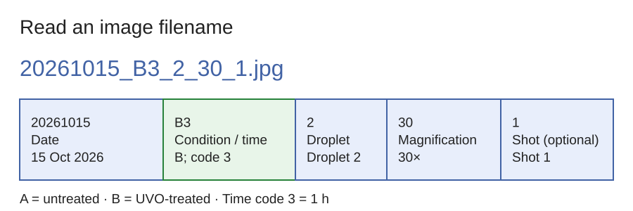
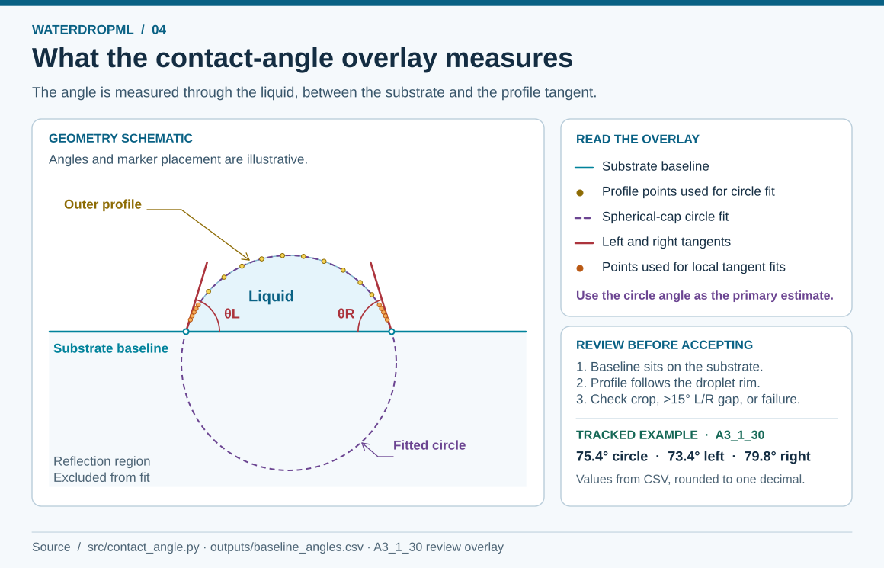

# WaterDropML: contact-angle extraction (v1.0)

This project measures sessile-droplet contact angles automatically from Keyence
side-view microscope images (Fenning Research Group, UCSD).

v1.0 is a **classical computer-vision baseline**. It measures every image, and
the droplet masks it saves will be used to train a U-Net segmentation model in
the next version.

---

## 1. Workflow overview



[Editable Excalidraw source](docs/diagrams/01-measurement-workflow.excalidraw)

### Why each step exists

| Step | Problem it solves |
|---|---|
| Orient | Raw frames are taken sideways. Rotating them means "up" is always away from the substrate. |
| Baseline + deskew | A contact angle is measured against the substrate, so the substrate must be found precisely. The sample is often tilted by 1–2°. |
| Ignore below baseline | The glass reflects the droplet. Without this, the reflection would be measured as part of the droplet. |
| Half-resolution gradients | JPEG noise at full resolution is as strong as the faint droplet rim, and downsampling suppresses it. |
| Convex hull → GrabCut | The hull is a robust first guess but cannot follow an undercut (θ > 90°). GrabCut refines the shape using colour. |
| Circle fit | It uses the whole profile, so it is insensitive to glare at the contact line. This makes it the most stable number. |
| Tangent fit | It gives separate left and right angles, which show asymmetry or pinning, but it is sensitive to glare. |

---

## 2. Repository layout



[Editable Excalidraw source](docs/diagrams/02-repository-map.excalidraw)

`all_annotated_images.zip` and `Contact angle.zip` are not in git. The first is
over GitHub's 100 MB file limit, and both are just zipped copies of folders that
are already included.

### Filename convention (from JayB)



[Editable Excalidraw source](docs/diagrams/03-filename-key.excalidraw)

`YYYYMMDD_<A|B><t>_<droplet>_<mag>[_<shot>].jpg`

| Field | Meaning |
|---|---|
| A / B | A = no UVO treatment, B = UVO-treated |
| t | treatment time: 1 = 0 min, 2 = 30 min, 3 = 1 h, 4 = 3 h |
| droplet | droplet 1 or 2 |
| mag | magnification: 20x, 30x or 50x |
| shot | shot sequence number (optional) |

---

## 3. Step-by-step: recreating v1.0

### 3.1 Install

```bash
git clone <this repo URL>
cd WaterDropML
python -m venv .venv
# Windows: .venv\Scripts\activate     macOS/Linux: source .venv/bin/activate
pip install -r requirements.txt
```

Tested with Python 3.10, OpenCV 4.x, SciPy 1.15, scikit-image 0.25 and pandas 2.

### 3.2 Put the images in place

The images are already in `data/raw/` in this repo. For a new batch, copy the
`.jpg` files into `data/raw/` and keep the filename convention above. Leave out
calibration and test shots.

### 3.3 Build the metadata index

```bash
python src/dataset.py data/raw
```

This writes `data/index.csv`, with one row per image giving the condition, time,
droplet, magnification and shot. It prints a count per group so you can check
nothing is missing. The current set has 59 images.

### 3.4 Run the measurement

```bash
python src/run_baseline.py                 # all images (~3 s per image)
python src/run_baseline.py --only A3_1_30  # just one image or a group (updates rows in place)
```

### 3.5 Check the results (do not skip this)



[Editable Excalidraw source](docs/diagrams/04-contact-angle-and-qc.excalidraw)

Open `outputs/overlays/<name>_overlay.jpg` for each image:

| Colour | Meaning |
|---|---|
| cyan line | detected substrate baseline |
| yellow dots | detected droplet profile |
| magenta circle | spherical-cap fit |
| red lines + numbers | left/right tangent angles |
| orange dots | points used for the tangent fit |

Accept a measurement only if the cyan line sits on the substrate and the yellow
dots follow the droplet's outer edge. Also check the `notes` column in
`outputs/baseline_angles.csv`:

- `left/right contact out of frame`: only one side can be measured, and the circle is fitted to a partial arc.
- `L/R disagree >15 deg`: glare at a contact point. Use `theta_circle`.
- `FAILED`: no droplet was found. This happens on very flat UVO droplets.

### 3.6 Compare with JayB's reference angles

The comparison uses JayB's ChatGPT-assisted estimates as a reference.

```python
import pandas as pd
a = pd.read_csv("outputs/baseline_angles.csv")
j = pd.read_csv("data/reference_jayb/jayb_angles.csv")
d = a.merge(j, on="file")
d["diff"] = d.theta_circle - d.theta_jayb
d.to_csv("outputs/comparison_vs_jayb.csv", index=False)
print(d.groupby("condition")["diff"].describe())
```

### 3.7 Use it on a single image from Python

```python
import sys; sys.path.insert(0, "src")
from contact_angle import measure
r = measure("data/raw/20261015_A3_1_30.jpg", out_dir="outputs/overlays", mask_dir="data/masks_auto")
print(r.theta_circle, r.theta_left, r.theta_right, r.notes)
```

### 3.8 Settings you can tune (in `src/contact_angle.py`)

| Function | Parameter | Effect |
|---|---|---|
| `detect_baseline` | `y_range` | Vertical band (fraction of height) searched for the substrate line |
| `segment_droplet` | `scale` | Working resolution. Lower is less noisy but coarser. |
| `tangent_angle` | `band_frac` | Height of the fit band above the contact line (default 25%) |
| `tangent_angle` | `margin_frac` | Rows skipped right at the contact line to avoid glare (default 4%) |

---

## 4. v1.0 results (2026-11-06)

- **A3_1_30:** circle fit 75.4°, left tangent 73.4°, right tangent 79.8°. JayB's estimate was 73.0°.
- **Agreement with JayB:** the median absolute difference is about 5.6° on the full untreated (A) 30x droplets and about 4° on the full UVO-treated (B) droplets. Neither set has been checked against a reference instrument yet.
- **Untreated (A) droplets:** about 75–80°.
- **UVO-treated (B) droplets:** about 5–20°, which is much more hydrophilic.

### Known limitations

- The tangent angles change by about 5–15° with the fit-band settings because of glare at the contact line. Use `theta_circle` as the primary number.
- Most 50x frames cut off one contact point.
- Some UVO droplets are wider than the frame at 20x and 30x. These give meaningless circle values (about 1–3° or 180°).
- 2 images (B2_1_30_1, B2_2_50_2) fail to segment.

---

## 5. Next step: U-Net segmentation (v2.0 plan)

v1.0 is the classical pipeline: there is no trained model yet. Its masks in
`data/masks_auto/` are the starting point for U-Net training labels. Some of them
trace the droplet's outer edge incorrectly, and a U-Net trained on those would
learn the same mistakes. The masks therefore have to be checked and corrected
before training.

### Step 1: Review every overlay

Go through `outputs/overlays/` and record each image in `data/qc_review.csv`:

```
file,status,problem
20261015_A3_1_30.jpg,good,
20261015_B2_1_20.jpg,bad,flat droplet missed
```

| Column | Values |
|---|---|
| `status` | `good` / `fixable` / `bad` |
| `problem` | `wrong baseline`, `leaks into reflection`, `cuts inside the rim`, `flat droplet missed`, `glare at contact point` |

This shows whether the errors are one recurring failure or many different ones.

### Step 2: Quick classical fixes (only if one problem dominates)

| Problem | Where to adjust in `src/contact_angle.py` |
|---|---|
| Wrong baseline | `detect_baseline`: narrow `y_range`, or add a per-image manual override |
| Outline cuts inside the rim | `segment_droplet`: lower the threshold multiplier (`1.5`), or raise `scale` to 0.75 |
| Outline leaks outward | raise that multiplier, or reduce the hull dilation (`iterations=3`) |
| Flat UVO droplets | needs hand labels (Step 3) |

Re-run the affected images with `python src/run_baseline.py --only <name>`, then
re-check the full set so a fix for a few images doesn't break others.

### Step 3: Hand-correct the masks (ground truth)

- **Tool:** CVAT or Label Studio. Load `data/masks_auto/*_upright.jpg` together
  with the matching `*_mask.png`, and correct the outline with polygon or brush
  tools.
- **Labeling rule:** label only the droplet *above* the substrate line,
  *including* the outer rim line. Exclude the reflection below the substrate.
  Everyone who labels follows this rule.
- **Where to save:** corrected masks go in a new folder, `data/masks_gt/`, with
  the same filenames. `masks_auto/` stays untouched for comparison.
- **First batch:** 15–20 images covering A and B, every treatment time and every
  magnification, including frames where one contact point is cut off. Start with
  the images marked `bad` or `fixable`.

### Step 4: Train the U-Net (`src/train_unet.py`, to be written)

| Setting | Choice | Reason |
|---|---|---|
| Model | U-Net, `segmentation-models-pytorch`, ResNet-34 encoder pretrained on ImageNet | Pretraining is essential with about 50 images |
| Input | upright images resized or tiled to 512 px, plus `masks_gt/` | |
| Augmentation | `albumentations`: horizontal flip, brightness/contrast, blur, ±3° rotation | No vertical flip: droplets always sit on top |
| Split | hold out whole droplets (`sample_id` in `data/index.csv`), not individual shots | Shots of one droplet in both train and test would inflate scores |
| Loss | Dice + BCE | |
| Hardware | laptop GPU or Google Colab (free tier) | |

Add these to `requirements.txt`: `torch`, `segmentation-models-pytorch`,
`albumentations`.

### Step 5: Evaluate against the classical baseline

Score both methods on the held-out images, using `masks_gt/` as ground truth:

1. **Mask IoU / Dice**
2. **Boundary error:** mean distance in pixels between the predicted outline and
   the true outline. This matters most, because angles depend on the edge.
3. **Angle error:** run each mask through the existing `circle_angle` /
   `tangent_angle` code and compare with the angle from `masks_gt/`.

If the U-Net wins, it replaces the segmentation step (③ in the workflow). The
baseline detection and angle fitting stay the same.

### Step 6: Iterate

Run the U-Net on all images, review the overlays, correct the worst predictions
and add them to `masks_gt/`, then retrain. Two or three rounds are usually
enough.

---

## 6. Roadmap

1. **v1.1:** review the overlays and build `data/masks_gt/` (Steps 1–3 above).
2. **v2.0:** train the U-Net and evaluate it against the classical baseline (Steps 4–6).
3. **Data:** build a water, acetone and IPA dataset on a dedicated contact-angle
   rig, as Eric suggested. It goes through the same label → train → evaluate loop.
4. **Validation:** measure a reference sample with known contact angles on the
   same Keyence setup.
5. **To confirm with JayB:** whether time codes 1–4 mean UVO exposure time or
   time elapsed after treatment.
