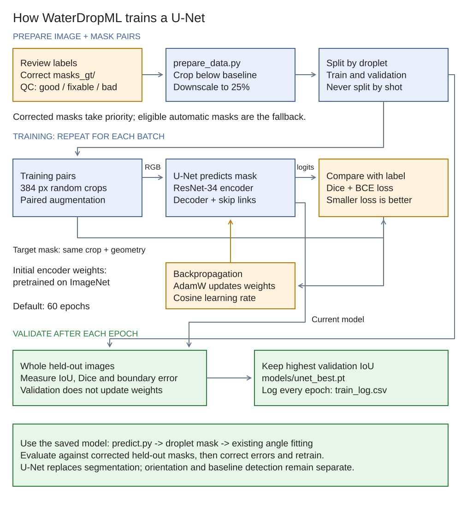

# U-Net guide: step by step

This guide takes WaterDropML from the classical v1.0 pipeline to a trained U-Net
that outlines the droplet. The angle-fitting code stays the same: the U-Net only
replaces the **segmentation** step (③ in the README workflow), so the two methods
can be compared fairly.

```
 raw image ─► orient + baseline (classical, unchanged)
                     │
        ┌────────────┴────────────┐
        ▼                         ▼
  classical segmentation      U-Net segmentation   ◄── trained on corrected masks
        │                         │
        └────────────┬────────────┘
                     ▼
         same angle fitting (contact_angle.angles_from_mask)
```

## Training diagram



Blue boxes show data and prediction, orange boxes show review and learning,
and green boxes show validation and outputs. Arrows into the loss carry the
prediction and its matching target mask; backpropagation updates the model.
Validation uses whole held-out images and does not update model weights.

The data builder prefers corrected masks and can fall back to automatic labels.
It excludes `bad` automatic labels, but still accepts `fixable` ones; correct
known errors before treating those masks as reliable training labels. Even with
`--gt-only`, validation follows the prepared metadata, so check that held-out
labels are corrected before interpreting the scores as ground-truth accuracy.

[Editable Excalidraw source](diagrams/05-unet-training.excalidraw).

## What a U-Net does here

A U-Net is a neural network that labels every pixel of an image, here as
"droplet" or "not droplet". It is good at this because it combines two views:

- **The encoder** shrinks the image step by step to understand context: this
  bright blob is a reflection *inside* a droplet, and that line is the
  substrate.
- **The decoder** scales back up to full size, with skip connections that carry
  fine detail from the encoder, so the outline lands on the right pixel.

We use a ResNet-34 encoder **pretrained on ImageNet**. It already knows edges,
textures and shapes, so it needs far fewer labelled images than a network
trained from scratch. With about 50 images, pretraining is essential.

The model learns whatever its labels show. If it is trained on the classical
masks only, it will copy their mistakes. That is why Step 3 (hand-correcting
masks) matters more than any training setting.

---

## Files

| File | Purpose |
|---|---|
| `src/unet/prepare_data.py` | builds the training set in `data/unet/` from upright images + masks |
| `src/unet/train.py` | trains the U-Net; saves `models/unet_best.pt` and `models/train_log.csv` |
| `src/unet/predict.py` | runs the model on images, then the standard angle fitting → `outputs/unet_angles.csv` |
| `src/unet/evaluate.py` | scores classical and U-Net masks against hand-corrected masks |
| `src/unet/common.py` | shared helpers (model, normalisation, metrics) |
| `notebooks/train_unet_colab.ipynb` | train on a free Google Colab GPU |

---

## Step 0: Install

On your laptop, from the WaterDropML folder:

```
pip install -r requirements.txt
pip install torch segmentation-models-pytorch
```

A CPU-only `torch` is fine on the laptop for **prediction**, which takes a few
seconds per image. For **training**, use a GPU: Google Colab's free T4
(Step 4b) is the easy option.

The first training run downloads the ImageNet encoder weights (about 85 MB) from
the internet.

## Step 1: Review the v1.0 overlays

Open each image in `outputs/overlays/` and record it in `data/qc_review.csv`:

```
file,status,problem
20261015_A3_1_30.jpg,good,
20261015_A1_2_30.jpg,fixable,glare at contact point
20261015_B2_1_20.jpg,bad,flat droplet wider than frame
```

`status` is `good`, `fixable` or `bad`. When the training set is built,
images marked `bad` are left out unless they have been hand-corrected.

## Step 2: Hand-correct masks (ground truth)

1. **Install a labelling tool.** CVAT (cvat.ai, free online, or run locally) or
   Label Studio both work.
2. **Load the images.** Import `data/masks_auto/<name>_upright.jpg`, and the
   matching `<name>_mask.png` as a starting point if the tool supports it.
   Fixing an existing outline is much faster than drawing a new one.
3. **Labelling rule** (everyone uses the same rule):
   - Label the droplet **above** the substrate line only.
   - **Include** the outer rim line of the droplet.
   - **Exclude** the reflection below the substrate, and any glare outside the
     droplet edge.
4. **Export** each mask as a black/white PNG, the same size as the upright
   image, to `data/masks_gt/<name>_mask.png`. The name must match the image,
   e.g. `20261015_A3_1_30_mask.png`.
5. **First batch:** 15–20 images. Cover A and B, all four times and all three
   magnifications, plus a few 50x frames where one contact point is cut off.
   Start with the images marked `bad` or `fixable` in Step 1.

You can start training before Step 2 is done (the next steps fall back to the
classical masks), but the model will only be as good as those masks.

## Step 3: Build the training set

```
python src/unet/prepare_data.py
```

What it does:

- **Chooses a label for each image:** the hand-corrected mask from `masks_gt/`
  if there is one, otherwise the classical mask from `masks_auto/`.
- **Leaves out unusable labels:** images the classical run failed on, images
  with an implausible classical angle (below 4° or above 170°), and images
  marked `bad` in Step 1.
- **Crops and shrinks:** each image is cropped from the top of the frame down
  to 160 px below the substrate (the reflection is kept, as an example of "not
  droplet"), then downscaled 4× to about 540 × 500 px.
- **Splits by droplet, not by shot.** The validation droplets default to
  `A3_1`, `B4_1` and `A2_2`. If shots of the same droplet were in both training
  and validation, the scores would look better than they really are. Change
  the validation droplets with `--val A3_1 B3_2 ...`.

It prints how many images went into train and val, and which label source each
uses. Current data: 52 images (41 train, 11 val), all classical labels so far.

## Step 4: Train

### 4a: On a laptop with an NVIDIA GPU

```
python src/unet/train.py
```

### 4b: On Google Colab (recommended if you have no GPU)

1. Build the bundle on your laptop:
   ```
   Compress-Archive -Path src, data\unet -DestinationPath unet_bundle.zip -Force
   ```
2. Open `notebooks/train_unet_colab.ipynb` in Colab (File → Upload notebook).
3. Choose Runtime → Change runtime type → **T4 GPU**.
4. Run the cells in order. They upload the bundle, install packages, train,
   plot the curves, show a validation example and download `unet_best.pt`.
5. Put `unet_best.pt` in `WaterDropML/models/` on your laptop.

### Training settings (defaults in `train.py`)

| Setting | Default | Notes |
|---|---|---|
| Encoder | ResNet-34, ImageNet weights | `--encoder resnet18` is smaller and faster |
| Crop size | 384 px | Random crops, 70% centred on the droplet outline so the model sees plenty of edges |
| Augmentation | left/right flip, ±3° rotation, ±10% scale, brightness/contrast, colour cast, blur, noise | No vertical flip: droplets always sit on top |
| Loss | Dice + binary cross-entropy | |
| Optimiser | AdamW, learning rate 3e-4 with cosine decay | |
| Epochs | 60 | About 10–20 min on a T4 |
| `--gt-only` | off | Train only on hand-corrected masks, once you have enough |

### Reading the training log

`models/train_log.csv` records each epoch. The console prints the same values.

| Column | Meaning | What to look for |
|---|---|---|
| `train_loss` | error on training crops | goes down steadily |
| `val_iou` | overlap with the labels on held-out droplets (0–1) | rises and levels off; above about 0.95 is good |
| `val_boundary_px_full` | average distance between predicted and label outline, in full-resolution pixels | the number that matters for angles; aim for a few px |

The best epoch by `val_iou` is saved automatically. If `train_loss` keeps
falling while `val_iou` gets worse, the model is memorising the training images
(overfitting). The remedy is more and more varied labels, not more epochs.

## Step 5: Predict and measure angles

```
python src/unet/predict.py              # all images
python src/unet/predict.py --split val  # only held-out droplets (the fair test)
python src/unet/predict.py --only A3_1_30
```

Outputs:

- `outputs/unet_angles.csv`: same columns as `baseline_angles.csv`, plus
  `theta_*_classical` and `theta_jayb` side by side.
- `outputs/overlays_unet/<name>_unet_overlay.jpg`: same colour code as v1.0.
- `data/masks_unet/<name>_unet_mask.png`: full-resolution masks.

Check the overlays exactly as in v1.0 (README section 3.5).

## Step 6: Evaluate against ground truth

Once `data/masks_gt/` has some masks:

```
python src/unet/evaluate.py
```

It compares both methods with your hand-corrected masks and writes
`outputs/eval_vs_gt.csv`:

- **Mask overlap:** `*_iou`.
- **Outline error:** `*_boundary_px`, in full-resolution pixels.
- **Angle error:** `*_err_circle`, `*_err_left`, `*_err_right`, in degrees,
  measured against the angle computed from the hand-corrected mask.

The summary is grouped by `split`. Only the **val** rows are a fair test of the
U-Net, because it has already seen the train images. Adopt the U-Net if it beats
the classical masks on boundary and angle error on the val droplets.

## Step 7: Iterate

1. Run `predict.py` on everything and review `outputs/overlays_unet/`.
2. Hand-correct the worst U-Net masks and save them to `data/masks_gt/`.
   Correcting the model's own mistakes is the fastest way to improve it.
3. Repeat Steps 3 → 4 → 6. After a few rounds, train with `--gt-only`.
4. New data (water/acetone/IPA, or the new rig) goes through the same loop.
   Add a few hand-corrected masks of each new liquid or setup.

---

## Status (2026-11-07)

- The full pipeline was smoke-tested end to end: prepare → train → predict →
  angles. That run used 4 epochs on CPU, without ImageNet weights (the download
  was blocked in that environment), and classical labels.
- That model is **not** usable. Its val IoU was 0.61, and its A3_1_30 outline
  was ragged. The test only confirms the code runs. Real training needs the
  pretrained encoder, a GPU and about 60 epochs (Step 4b).
- Next actions:
  - Step 1 (QC review).
  - Step 2 (first 15–20 hand-corrected masks).
  - Step 4b (first real training run on Colab).

## Troubleshooting

| Symptom | Fix |
|---|---|
| `ProxyError` / download error when training starts | No internet for the ImageNet weights. Train on Colab, or add `--no-pretrained` (much worse results). |
| `CUDA out of memory` | `--batch 4` or `--crop 320` |
| `need at least one train and one val image` | Re-run `prepare_data.py`, and check that the `--val` names match `sample_id`s in `data/index.csv` |
| Outline ragged or blobby | Not trained long enough, or not pretrained. Check `train_log.csv`. |
| Good IoU but angles still off | The outline is fine and the angle fit is the problem. See README "Known limitations" and the angle-method plan. |
