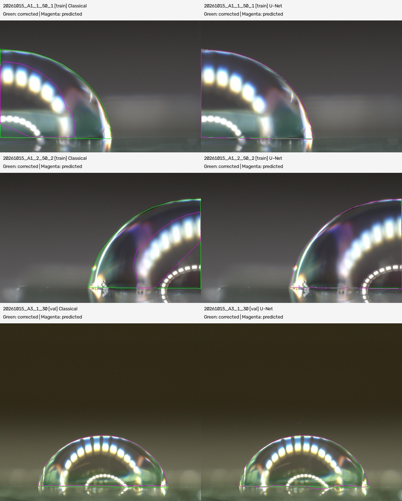

# Corrected-label U-Net pilot — 2026-11-08

The first corrected-label pilot completed 60 epochs using an ImageNet-pretrained
ResNet34 U-Net on an RTX 4090 Laptop GPU. Only three hand-corrected masks were used.

## Data split

| Image | Role |
|---|---|
| 20261015_A1_1_50_1 | Training |
| 20261015_A1_2_50_2 | Training |
| 20261015_A3_1_30 | Validation and checkpoint selection |

The split keeps whole droplets separate. Automatic labels were excluded from
training. Corrected full-resolution binary masks are in `../../data/masks_gt/`;
the original automatic masks remain available for comparison. Archive names,
mask hashes, and split assignments are recorded in [import_manifest.json](import_manifest.json).

## Held-out validation results

Best checkpoint: epoch 36 of 60. These values are for A3_1_30 only.

| Metric | Classical automatic mask | U-Net |
|---|---:|---:|
| IoU | 97.19% | 97.39% |
| Dice | 98.57% | 98.68% |
| Mean symmetric boundary distance, full-resolution pixel units | 4.32 | 4.23 |

The IoU improvement is **0.20 percentage points** on a validation example where
the classical method already worked well. The two training images reach about
99.3–99.4% IoU; those are training fits, not evidence of generalization.

Scores use quarter-resolution baseline crops and raw predictions thresholded
at 0.5, with horizontal-flip test-time averaging and no mask postprocessing.
Boundary distances are measured at quarter resolution and divided by 0.25.
See [metrics.csv](metrics.csv) for all three images and [train_log.csv](train_log.csv)
for all 60 epochs. [summary.json](summary.json) records configuration and checkpoint hash.



Green is the hand-corrected outline; magenta is the prediction. Left panels use
classical masks and right panels use U-Net predictions. The first two rows are
training examples; only the bottom row is validation.

## Repeat the pilot

From the repository root, with the project dependencies installed:

```powershell
python src/unet/prepare_data.py --angles outputs/corrected_pilot_20261108/pilot_angles.csv --out data/unet_corrected_pilot_20261108 --val A3_1
python -u src/unet/train.py --data data/unet_corrected_pilot_20261108 --out models/corrected_self_run --gt-only --epochs 60 --crop 256 --batch 8 --samples-per-image 32
```

On the existing Windows installation, use `.\.venv\Scripts\python.exe` in
place of `python`, from `C:\Users\Lawre\Desktop\ML`. Confirm `device: cuda`.
Use a fresh output folder for each experiment. Exact numerical results may vary
with hardware and nondeterministic GPU operations despite the default seed of 0.

| Option | Meaning |
|---|---|
| `--gt-only` | Use hand-corrected training masks only. |
| `--epochs 60` | Repeat training for 60 rounds. |
| `--crop 256` | Learn from random 256 × 256 patches of the downscaled images. |
| `--batch 8` | Process eight patches per weight update. |
| `--samples-per-image 32` | Sample 32 patches per training image per epoch. |

With two training images, each epoch uses 64 patches and eight weight updates.
Training saves `unet_best.pt` and `train_log.csv` in the chosen output folder.
The original pilot weights remain local under `models/corrected_pilot_20261108/`;
the 98 MB checkpoint is not part of this results update. The repeat command
trains a new model; it does not resume those weights. CVAT is not needed to train.

## Interpretation and next validation

This establishes that the training pipeline works on corrected labels. One
validation image, also used for checkpoint selection, is not an independent
test set and cannot establish performance across treatments or magnifications.
Contact-angle accuracy has not been evaluated in this pilot.

Next, run predictions on unseen droplets, inspect their outer rim and contact
points, and independently correct a representative test set covering A/B,
magnification, lighting, flat droplets, and partial views. Keep that test set
out of training and checkpoint selection. Compare both mask quality and contact
angles against trusted measurements before replacing the classical pipeline.
