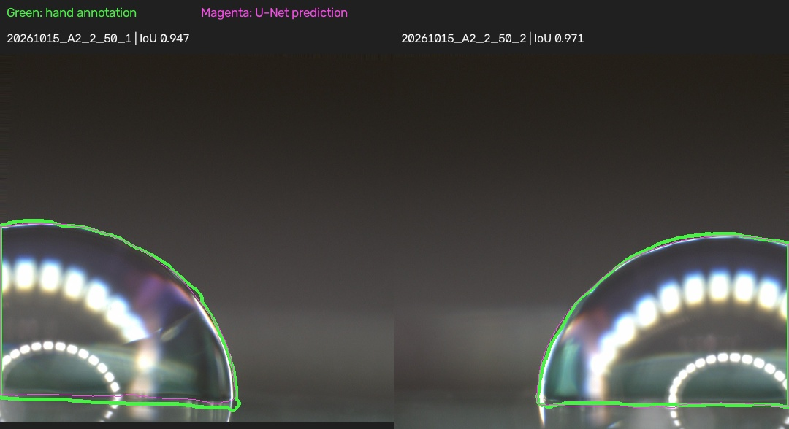

# Expanded hand-corrected U-Net run

The U-Net trained for 60 epochs on hand-corrected droplet masks using PyTorch
2.6.0 with CUDA 12.4 on an NVIDIA RTX 4090 Laptop GPU. The best checkpoint was
epoch **13**, selected by mean validation IoU.

## Dataset

| Split | Images | Droplets | Droplet IDs |
| --- | ---: | ---: | --- |
| Training | 9 | 6 | A1_1, A1_2, A2_1, A3_2, A4_1, A4_2 |
| Validation | 3 | 1 | A3_1 |
| Test | 2 | 1 | A2_2 |

The dataset combines 11 unique Label Studio images and three CVAT masks. Four
repeat Label Studio annotations were removed. Label Studio masks were thresholded
at 128 and small enclosed brush gaps were filled. The CVAT masks were decoded
from the droplet label color. The prepared inputs use the baseline crop with
160 pixels below the substrate and a 0.25 scale. See [data_split.csv](data_split.csv)
for image-level assignments and annotation provenance.

## Results

| Split | Mean IoU | Mean Dice | Mean boundary distance (full-resolution px) |
| --- | ---: | ---: | ---: |
| Validation | 96.13% | 98.02% | 8.94 |
| Test | **95.91%** | **97.91%** | **12.51** |

Scores use whole prepared images, horizontal-flip prediction averaging, and a
0.5 probability threshold. The boundary metric is the mean symmetric outline
distance in full-resolution pixel units. The two test images show different
views of one droplet. Some annotations still extend into the reflection below
the contact line. These scores measure mask agreement on this split. Contact-angle
accuracy remains unmeasured.



See [per-image metrics](held_out_metrics.csv) and the [60-epoch training log](train_log.csv).

## Training command

Run from the repository root with the project dependencies installed and the
locally prepared `data/unet_handcorrected_20261108` dataset.

```powershell
python -u src/unet/train.py --data data/unet_handcorrected_20261108 --out models/handcorrected_repeat --gt-only --epochs 60 --encoder resnet34 --crop 256 --batch 8 --samples-per-image 16 --lr 0.0003 --seed 0
```

The ResNet-34 encoder starts from ImageNet weights. The trained checkpoint is
stored locally at `models/handcorrected_20261108/unet_best.pt`.

Checkpoint SHA-256

`081e5b03f7be25574c266b214d2b984198850ca385048e80afbe5545986107d7`
